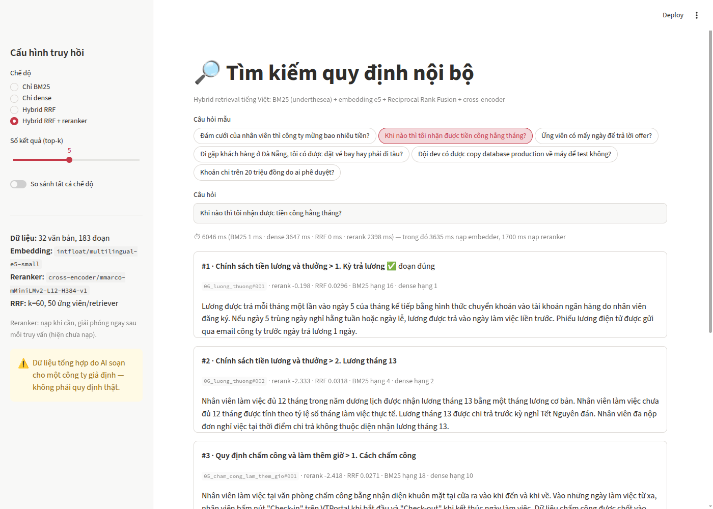
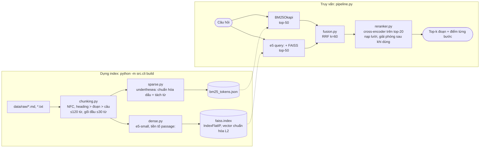

# viet-retrieve — Hybrid retrieval cho văn bản tiếng Việt

Hệ thống nhận một câu hỏi tiếng Việt và trả về top-k đoạn văn bản liên quan nhất, kết hợp **BM25 (tách từ
underthesea)**, **dense retrieval (multilingual-e5-small + FAISS)**, **Reciprocal Rank Fusion** và
**cross-encoder reranker**. Chạy hoàn toàn trên CPU, có demo Streamlit và bộ đánh giá có số liệu đo thực tế.

> ⚠️ **Dữ liệu tổng hợp.** 32 văn bản trong `data/raw/` và 50 câu hỏi đánh giá đều do AI (Claude) soạn cho một
> công ty **giả định**; không phải quy định thật của tổ chức nào. Xem [data/README.md](data/README.md).



## Mục lục

1. [Bài toán và động lực](#1-bài-toán-và-động-lực)
2. [Kết quả chính](#2-kết-quả-chính)
3. [Kiến trúc](#3-kiến-trúc)
4. [Cài đặt và chạy](#4-cài-đặt-và-chạy)
5. [Các lựa chọn thiết kế và cách điều chỉnh](#5-các-lựa-chọn-thiết-kế-và-cách-điều-chỉnh)
6. [Đánh giá chi tiết và phân tích](#6-đánh-giá-chi-tiết-và-phân-tích)
7. [Hạn chế đã biết](#7-hạn-chế-đã-biết)
8. [Hướng phát triển](#8-hướng-phát-triển)
9. [Cấu trúc thư mục](#9-cấu-trúc-thư-mục)

## 1. Bài toán và động lực

Nhân viên hỏi về quy định nội bộ bằng ngôn ngữ đời thường, còn văn bản viết bằng ngôn ngữ hành chính:

| Người dùng hỏi | Văn bản viết |
|---|---|
| "công ty có trả **tiền cơm trưa** không?" | "**phụ cấp ăn trưa** 50.000 đồng…" |
| "ứng viên có mấy ngày để trả lời **offer**?" | "**thư mời nhận việc** … có giá trị trong 7 ngày" |
| "chồng được nghỉ bao lâu khi **vợ đẻ**?" | "lao động nam có **vợ sinh con** được nghỉ…" |

- **BM25** mạnh với từ khóa, con số, mã văn bản nhưng không hiểu từ đồng nghĩa.
- **Dense retrieval** hiểu diễn đạt khác nhau nhưng có thể bỏ sót chi tiết chính xác (số, tên riêng).
- **Hybrid (RRF)** gộp hai danh sách mà không cần chuẩn hóa điểm; **reranker** (cross-encoder) đọc đồng thời câu
  hỏi và đoạn văn để xếp lại vài chục ứng viên đầu cho chính xác hơn.

Tiếng Việt có thêm khó khăn riêng: khoảng trắng tách **âm tiết** chứ không tách **từ** ("nghỉ phép" là một từ),
hai kiểu đặt dấu ("khoẻ"/"khỏe", "hoà"/"hòa"), và văn bản lẫn dạng Unicode NFC/NFD. Ràng buộc của dự án:
**chỉ dùng CPU**, RAM và ổ đĩa hạn chế → model nhỏ, nạp lười (lazy) và giải phóng sau khi dùng.

## 2. Kết quả chính

50 câu hỏi (26 *keyword* — dùng lại từ khóa của văn bản, 24 *paraphrase* — diễn đạt khác), 183 đoạn,
CPU Intel i5-12400. Số liệu sinh bởi `python -m eval.evaluate`, đầy đủ trong [eval/results.md](eval/results.md).

| Cấu hình | Recall@1 | Recall@5 | MRR@10 | Độ trễ TB / truy vấn |
|---|---:|---:|---:|---:|
| Chỉ BM25 | 0.700 | 0.840 | 0.752 | 0.6 ms |
| Chỉ dense (e5-small) | 0.800 | **0.940** | 0.865 | 6.8 ms |
| Hybrid RRF | 0.720 | 0.920 | 0.806 | 7.4 ms |
| **Hybrid RRF + reranker** (mMiniLM, mặc định) | **0.860** | **0.940** | **0.893** | 281.8 ms |
| Hybrid RRF + reranker (bge-reranker-base, so sánh) | 0.800 | **0.940** | 0.864 | 929.7 ms |

- **Tốt nhất: Hybrid RRF + reranker mMiniLM** — cao nhất ở mọi metric chính, đúng 26/26 câu keyword ở hạng 1.
  Nhưng lợi thế so với **dense đơn lẻ** mới là 4 câu thắng / 1 câu thua (kiểm định McNemar p = 0.375): **chưa có ý
  nghĩa thống kê** với 50 câu. Nếu cần độ trễ thấp, dense đơn lẻ (6.8 ms) là lựa chọn rất cạnh tranh.
- **Hybrid RRF trọng số đều kém hơn dense đơn lẻ** trên bộ dữ liệu này — xem phân tích ở [mục 6](#6-đánh-giá-chi-tiết-và-phân-tích).
- Độ trễ không gồm thời gian nạp model (đo riêng, với `HF_HUB_OFFLINE=1`): embedder ~3.2 s một lần; reranker ~1.6 s
  mỗi lần nạp.

## 3. Kiến trúc



Bốn chế độ dùng chung pipeline: `bm25` (chỉ nhánh trên), `dense` (chỉ nhánh dưới), `hybrid` (dừng sau RRF),
`hybrid_rerank` (đầy đủ). Mỗi kết quả trả về kèm hạng BM25, hạng dense, điểm RRF, điểm rerank để giải thích.

| Module | Vai trò |
|---|---|
| [src/config.py](src/config.py) | Đọc `config.yaml` thành dataclass có kiểm tra; ghi đè `--set mục.khóa=giá_trị` |
| [src/chunking.py](src/chunking.py) | Đọc `.md`/`.txt`, chuẩn hóa NFC, chia đoạn theo mục + câu, có gối đầu |
| [src/sparse.py](src/sparse.py) | Tokenizer tiếng Việt (underthesea / âm tiết) + BM25 (`rank_bm25`) |
| [src/dense.py](src/dense.py) | Embedder e5 (nạp lười) + FAISS `IndexFlatIP`, mã hóa kho theo lô nhỏ |
| [src/fusion.py](src/fusion.py) | Reciprocal Rank Fusion có trọng số, hòa điểm xác định |
| [src/reranker.py](src/reranker.py) | Cross-encoder, nạp lười và giải phóng sau khi dùng |
| [src/lazy.py](src/lazy.py) | `LazyModel`: nạp khi cần, `hold()` giữ model trong một batch, giải phóng + `malloc_trim` |
| [src/pipeline.py](src/pipeline.py) | Dựng/nạp index (tự build lại khi dữ liệu hoặc cấu hình đổi), truy vấn 4 chế độ |
| [src/cli.py](src/cli.py) | `download-models`, `build`, `search`, `info` |
| [eval/](eval/) | Tạo bộ đánh giá, đánh giá, phân tích độ nhạy RRF |
| [app.py](app.py) | Demo Streamlit, có chế độ so sánh 4 cấu hình cạnh nhau |

## 4. Cài đặt và chạy

Yêu cầu: Python ≥ 3.11, ~1.7 GB đĩa cho thư viện (torch bản CPU) và ~1 GB cho model. Không cần GPU, không cần API key.
Các lệnh dưới đây đã được chạy thử trên Linux (Python 3.11.16).

```bash
# 1. Môi trường — cài torch bản CPU TRƯỚC (bản mặc định trên PyPI kéo theo ~3 GB thư viện CUDA)
uv venv --python 3.11 .venv            # hoặc: python3.11 -m venv .venv
source .venv/bin/activate
uv pip install torch==2.15.0 --index-url https://download.pytorch.org/whl/cpu
uv pip install -r requirements.txt     # với pip thuần: bỏ "uv" ở hai lệnh trên

# 2. Tải model (chỉ file cần thiết): e5-small ~0.47 GB + reranker mMiniLM ~0.47 GB
python -m src.cli download-models      # thêm --with-extra để tải cả bge-reranker-base (~1.1 GB) cho bảng so sánh

# 3. Dựng index (chia đoạn + BM25 + FAISS), ~10–15 giây (phần lớn là nạp model embedding)
python -m src.cli build

# 4. Truy vấn từ dòng lệnh (chế độ: bm25 | dense | hybrid | hybrid_rerank)
python -m src.cli search "Tôi được nghỉ phép bao nhiêu ngày một năm?" --mode hybrid_rerank --top-k 3

# 5. Demo
streamlit run app.py                   # mở http://localhost:8501

# 6. Đánh giá
python -m eval.make_eval_set           # câu hỏi seed -> id đoạn đúng (theo cách chia đoạn hiện tại)
python -m eval.evaluate                # 4 cấu hình + reranker so sánh -> eval/results.md (~1.5 phút)
python -m eval.evaluate --extra-rerankers   # bỏ dòng so sánh bge-reranker-base (không cần tải thêm 1.1 GB)
python -m eval.sensitivity             # độ nhạy của RRF -> eval/ablations/rrf_sensitivity.md

# 7. Kiểm thử
pytest                                 # 70 test, không cần model
pytest -m slow                         # test dùng model e5 thật
```

Mẹo:

- Sau lần tải model đầu tiên, đặt `export HF_HUB_OFFLINE=1` để không gọi mạng khi nạp model (đo trên máy dev:
  nạp reranker ~1.5 s thay vì ~3–4 s). Các biến môi trường tùy chọn nằm trong [.env.example](.env.example).
- Không tải được model? `python -m src.cli build --no-dense` dựng index chỉ có BM25; CLI và demo vẫn chạy ở chế độ `bm25`.
- Dùng dữ liệu của bạn: thay file trong `data/raw/` (`.md` hoặc `.txt`). Index tự build lại khi phát hiện dữ liệu
  hoặc cấu hình chia đoạn thay đổi; bộ câu hỏi cần soạn lại trong `eval/questions_seed.yaml`.

**Docker** (đã kiểm tra cú pháp bằng `docker build --check`, **chưa build thử** trên máy dev vì thiếu dung lượng đĩa —
image ước tính ~3 GB):

```bash
docker build -t viet-retrieve .                  # tải sẵn model + dựng index trong image
docker run --rm -p 8501:8501 viet-retrieve
```

## 5. Các lựa chọn thiết kế và cách điều chỉnh

Mọi tham số nằm trong [config.yaml](config.yaml); có thể ghi đè khi đánh giá, ví dụ
`python -m eval.evaluate --set fusion.rrf_k=30 --output eval/ablations/k30.md`.

| Thành phần | Lựa chọn | Lý do | Điều chỉnh |
|---|---|---|---|
| Embedding | `intfloat/multilingual-e5-small` (118M tham số, 384 chiều, ~0.47 GB) | Nhẹ hơn nhiều so với `BAAI/bge-m3` (568M, ~2.3 GB) nên nạp nhanh và truy vấn ~7 ms trên CPU; có tiếng Việt trong dữ liệu huấn luyện. Đánh đổi: chất lượng thấp hơn bge-m3 một chút. | `dense.model_name` (index tự build lại); nhớ chỉnh `query_prefix`/`passage_prefix` theo model |
| Reranker | `cross-encoder/mmarco-mMiniLMv2-L12-H384-v1` (118M, ~0.47 GB) | Nhỏ hơn bge-reranker-base (278M, ~1.1 GB) và được huấn luyện trên mMARCO có tiếng Việt; trên bộ đánh giá: tốt hơn (R@1 0.86 so với 0.80) và nhanh hơn ~3 lần. **Lưu ý:** model mặc định được chọn sau khi so sánh hai reranker trên chính bộ đánh giá này (không có tập dev riêng) nên kết quả có thể hơi lạc quan. | `reranker.model_name`; `BAAI/bge-reranker-base` (MIT) vẫn chạy được |
| Tách từ BM25 | `underthesea` (`text_normalize` + `word_tokenize`) | Cài đặt suôn sẻ trên Python 3.11 nên không cần `pyvi`; chuẩn hóa kiểu bỏ dấu (`khoẻ`→`khỏe`, `qui`→`quy`) cho cả câu hỏi lẫn văn bản; gộp từ ghép (`nghỉ_phép`). Ablation: tách theo âm tiết R@1 0.66, không bỏ stopword 0.68 so với 0.70 — chênh 1–2 câu, nằm trong nhiễu. | `sparse.tokenizer: syllable` (không cần thư viện), `sparse.remove_stopwords` |
| Chia đoạn | Theo cấu trúc: heading → đoạn văn/gạch đầu dòng → câu; gom câu tới **120 từ**, gối đầu bằng **câu nguyên vẹn ≤ 30 từ**, không trộn hai mục; tiêu đề "Văn bản > Mục" được thêm vào nội dung index | Một đoạn ≈ một mục quy định nên ngữ nghĩa trọn vẹn; đo bằng tokenizer e5: 36–147 token/đoạn (trung vị 87), thừa chỗ trong giới hạn 512 token của e5/reranker. Với kho mẫu, mọi mục ≤ 114 từ nên mỗi đoạn đúng bằng một mục và **gối đầu không phát sinh**; gối đầu chỉ có tác dụng với mục dài hoặc file `.txt` không có heading (có unit test). | `chunking.*` (bộ đánh giá tự ánh xạ lại bằng `make_eval_set`) |
| Vector store | FAISS `IndexFlatIP`, vector chuẩn hóa L2 tường minh trước khi index và khi tìm | Tích vô hướng = cosine; tìm kiếm chính xác, đủ nhanh với vài nghìn đoạn | Đổi sang HNSW/IVF khi kho lớn |
| Fusion | RRF k = 60, 50 ứng viên mỗi retriever, trọng số 1.0 | Giá trị chuẩn trong bài báo gốc; không tinh chỉnh trên tập đánh giá để tránh overfit | `fusion.rrf_k`, `fusion.candidates_per_retriever`, `fusion.bm25_weight`, `fusion.dense_weight` |
| Bộ nhớ | Embedder nạp ở truy vấn dense đầu tiên rồi giữ lại; reranker chỉ nạp khi có truy vấn cần xếp hạng lại và **giải phóng ngay sau đó**; đánh giá chạy theo batch 10 câu, mã hóa kho theo lô 16 đoạn | Đáp ứng yêu cầu tiết kiệm RAM. Đo được khi đánh giá: RSS 1054 → 1656 MiB khi giữ reranker mMiniLM → 1089 MiB sau khi giải phóng (nhờ `gc` + `malloc_trim`). Đánh đổi: mỗi truy vấn rerank ở demo tốn thêm ~1.5 s nạp model. | `reranker.release_after_use: false` để giữ model (truy vấn nhanh hơn, tốn RAM hơn); `eval.batch_size`, `dense.batch_size` |

## 6. Đánh giá chi tiết và phân tích

### Bộ đánh giá

- 50 câu hỏi trong [eval/questions_seed.yaml](eval/questions_seed.yaml), mỗi câu kèm **đoạn trích nguyên văn**
  (evidence) từ văn bản nguồn. [eval/make_eval_set.py](eval/make_eval_set.py) chia đoạn theo cấu hình hiện tại
  rồi gán câu hỏi với chunk chứa evidence → nhãn không bị hỏng khi đổi `chunk_size`. Script báo lỗi nếu evidence
  không khớp, và cảnh báo nếu evidence xuất hiện ở văn bản khác (câu hỏi mơ hồ).
- **Câu hỏi do LLM (Claude) soạn**, cùng phiên với văn bản → có thể sát cách diễn đạt của văn bản hơn câu hỏi
  người dùng thật; nhãn keyword/paraphrase mang tính chủ quan. **Nên kiểm tra thủ công ít nhất 10–15 câu** (câu có
  trả lời được chỉ từ đoạn đúng không, cách hỏi có tự nhiên không) trước khi dùng số liệu để ra quyết định.
- Recall@k = tỷ lệ câu có đoạn đúng trong top-k; MRR@10; nDCG@5; độ trễ = thời gian `pipeline.search()` khi model đã nạp.

### Theo loại câu hỏi

| Cấu hình | keyword R@1 | keyword MRR | paraphrase R@1 | paraphrase R@5 | paraphrase MRR |
|---|---:|---:|---:|---:|---:|
| Chỉ BM25 | 0.962 | 0.981 | 0.417 | 0.667 | 0.505 |
| Chỉ dense | 0.923 | 0.962 | 0.667 | 0.875 | 0.759 |
| Hybrid RRF | 0.962 | 0.981 | 0.458 | 0.833 | 0.616 |
| Hybrid RRF + reranker (mMiniLM) | **1.000** | **1.000** | **0.708** | **0.875** | **0.778** |
| Hybrid RRF + reranker (bge-reranker-base) | 0.962 | 0.981 | 0.625 | 0.875 | 0.738 |

### Phân tích

1. **BM25 gần như hoàn hảo với câu keyword (R@1 0.96) nhưng thất bại với paraphrase (R@1 0.42)** — đúng như kỳ vọng:
   "tiền cơm" không khớp từ nào với "phụ cấp ăn trưa".
2. **Dense là baseline rất mạnh** (R@1 0.80, R@5 0.94 với 6.8 ms): e5-small hiểu phần lớn paraphrase, chỉ kém BM25 một
   chút ở câu cần khớp chính xác (q14 "Đà Nẵng… vé bay", q23, q28 "offer").
3. **Hybrid RRF trọng số đều lại kém dense** (R@1 0.72, MRR 0.806). Nguyên nhân không phải lỗi cài đặt mà là bản chất
   của RRF: điểm chỉ phụ thuộc thứ hạng nên ưu tiên đoạn có mặt ở *cả hai* danh sách. Với câu paraphrase, BM25 thường
   không tìm thấy đoạn đúng; đoạn dense xếp hạng 1 chỉ nhận 1/61 ≈ 0.016 điểm, thua những đoạn "trung bình" ở cả hai
   danh sách (2/65 ≈ 0.031). Ví dụ q37 "Đám cưới… mừng bao nhiêu tiền?": dense hạng 1 → hybrid hạng 7.
   Phân tích độ nhạy ([eval/ablations/rrf_sensitivity.md](eval/ablations/rrf_sensitivity.md)): đổi k (10–100) hay số
   ứng viên (10–50) gần như không ảnh hưởng (MRR 0.80–0.81); giảm trọng số BM25 xuống 0.25 cải thiện paraphrase
   (MRR 0.616 → 0.707) nhưng tổng thể (0.840) vẫn dưới dense — và vì đo trên chính tập đánh giá nên không được dùng để
   chọn tham số.
4. **Reranker sửa được thứ tự của RRF**: đoạn đúng nằm trong top-20 ứng viên RRF ở 48/50 câu, và cross-encoder đọc
   đồng thời câu hỏi + đoạn nên đưa được phần lớn chúng lên hạng 1. Kết quả là cấu hình mặc định tốt nhất ở cả hai loại
   câu hỏi. **Chọn reranker quan trọng**: bge-reranker-base (huấn luyện chủ yếu trên tiếng Anh/Trung) chỉ ngang dense,
   chậm hơn ~3 lần và tốn thêm ~520 MiB RAM lúc đỉnh (2180 so với 1656 MiB).
5. **Ý nghĩa thống kê** (McNemar chính xác trên Recall@1, so với cấu hình mặc định): khác biệt có ý nghĩa với BM25
   (10 thắng / 2 thua, p = 0.039) và Hybrid RRF (8 / 1, p = 0.039); **chưa có ý nghĩa** với dense (4 / 1, p = 0.375) và
   bge-reranker-base (3 / 0, p = 0.25). Cần bộ đánh giá lớn hơn để kết luận chắc chắn.
6. **Độ trễ**: reranker chiếm gần hết thời gian (~270 ms cho 20 cặp trên CPU); BM25 0.6 ms, dense 6.8 ms.
7. **7 câu cấu hình tốt nhất còn trượt ở hạng 1 đều là paraphrase**, chủ yếu cần liên tưởng thế giới thực mà model nhỏ
   chưa có: "thẻ nhớ" ≈ "thiết bị lưu trữ / USB" (q20), "tiền mạng" ≈ "internet" (q08), "chatbot miễn phí" ≈ "công cụ
   AI công cộng" (q49); hoặc gặp hard negative cố ý (q18: "giữ bí mật sau khi nghỉ việc" khớp cả quy trình nghỉ việc).

## 7. Hạn chế đã biết

- **Dữ liệu và câu hỏi đều tổng hợp, do cùng một LLM soạn**; 50 câu là nhỏ (mỗi câu = 2 điểm Recall@1) → số liệu chỉ
  để so sánh tương đối, không phản ánh trực tiếp hiệu năng trên dữ liệu thật.
- Reranker mặc định được chọn sau khi xem kết quả trên chính bộ đánh giá (không có tập dev/test tách biệt).
- e5-small và mMiniLM là model nhỏ: yếu với paraphrase cần kiến thức nền (xem mục 6.7).
- BM25: tách từ underthesea đôi khi không nhất quán giữa câu hỏi và văn bản (`nghỉ_phép` / `phép_năm`); không chuẩn hóa
  số ("20 triệu" ≠ "20.000.000"); IDF của `BM25Okapi` suy biến với kho rất nhỏ (≤ 2 đoạn).
- Chia đoạn chỉ nhận heading Markdown; `.txt` không cấu trúc dựa vào tách câu bằng regex; chưa xử lý bảng, PDF, DOCX.
- Với `release_after_use: true`, mỗi truy vấn rerank trên demo tốn thêm ~1.5 s nạp model (đổi RAM lấy độ trễ).
- Không có cập nhật index tăng dần: đổi dữ liệu là build lại toàn bộ (vài giây với kho mẫu); `IndexFlatIP` duyệt
  toàn bộ nên chỉ phù hợp kho cỡ nhỏ–vừa.
- Docker image mới được kiểm tra cú pháp, chưa build/chạy thử.
- Giấy phép: mMiniLM (Apache-2.0) huấn luyện trên mMARCO — bản dịch máy của MS MARCO, vốn có điều khoản sử dụng
  phi thương mại; cần kiểm tra trước khi dùng cho mục đích thương mại (bge-reranker-base là MIT).

## 8. Hướng phát triển

- Bộ đánh giá thật do người gán nhãn, tách tập dev/test để tinh chỉnh RRF (trọng số, số ứng viên) mà không overfit.
- Thử model mạnh hơn khi tài nguyên cho phép (bge-m3 dense + sparse, bge-reranker-v2-m3, model chuyên tiếng Việt) và
  đo trên cùng bộ đánh giá; fine-tune e5 trên cặp (câu hỏi, đoạn) tổng hợp theo miền.
- Mở rộng truy vấn: chuẩn hóa số và đơn vị, từ điển đồng nghĩa hành chính ↔ đời thường, viết tắt.
- Điều phối thông minh: bỏ qua reranker khi BM25 và dense đồng thuận; lượng tử hóa reranker (ONNX/OpenVINO int8) để
  giảm độ trễ.
- Thêm bước sinh câu trả lời (RAG) có trích dẫn đoạn nguồn; hỗ trợ PDF/DOCX, cập nhật index tăng dần, HNSW cho kho lớn.
- CI: chạy `pytest` + `eval.evaluate` và chặn merge nếu metric giảm.

## 9. Cấu trúc thư mục

```
config.yaml                 # mọi tham số
requirements.txt            # phiên bản đã kiểm tra (cài torch CPU trước)
Dockerfile, .dockerignore, .env.example
app.py                      # demo Streamlit
src/                        # thư viện: config, chunking, sparse, dense, fusion, reranker, lazy, pipeline, metrics, cli
eval/
  questions_seed.yaml       # 50 câu hỏi + đoạn trích bằng chứng (tổng hợp)
  make_eval_set.py          # -> eval_set.jsonl (câu hỏi -> id đoạn đúng)
  evaluate.py               # -> results.md (+ runs/*.jsonl chi tiết từng truy vấn, không commit)
  sensitivity.py            # độ nhạy RRF -> ablations/rrf_sensitivity.md
  results.md                # kết quả đánh giá chính
  ablations/                # ablation tokenizer BM25, độ nhạy RRF
data/
  raw/                      # 32 văn bản tổng hợp
  index/                    # artifact sinh bởi build (không commit)
docs/                       # ảnh chụp demo
tests/                      # 70 test (+1 test chậm dùng model thật)
```

Môi trường đã kiểm tra: Linux 6.8, Intel i5-12400 (12 luồng), 15 GB RAM, không GPU, Python 3.11.16, torch 2.15.0+cpu,
sentence-transformers 6.2.0, transformers 5.22.2, faiss-cpu 1.15.1, underthesea 9.5.0, streamlit 1.67.0.
